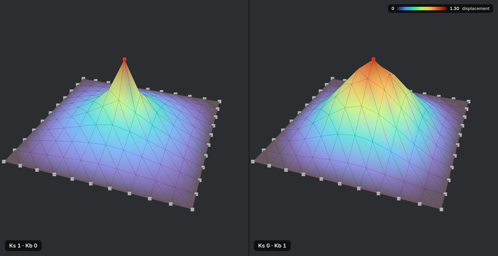
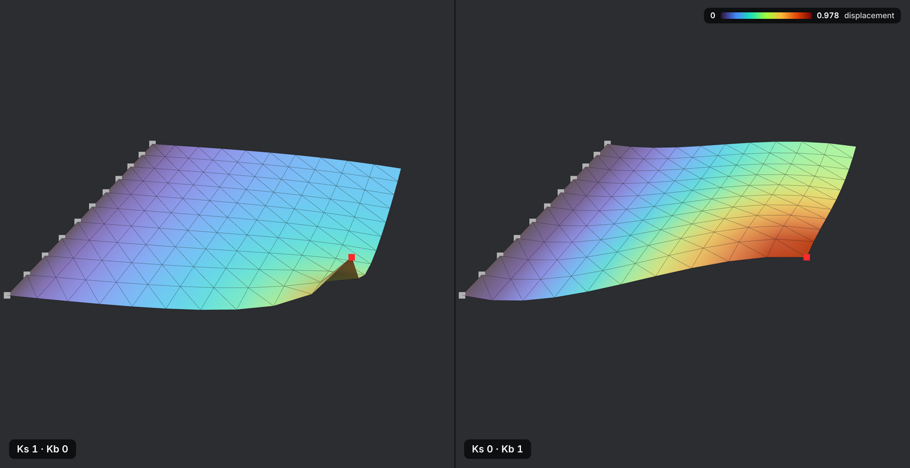
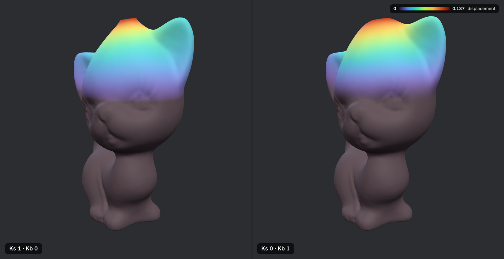

# Laplacian Deformer

Interactive surface deformation of triangle meshes: pin some vertices, drag others, and the rest of the surface follows smoothly. The deformation minimises a weighted sum of a **stretching** energy and a **bending** energy, following Botsch & Sorkine's survey of linear variational deformation methods.



*Same drag, two energies. The centre vertex is pulled up while the border is fixed. **Left:** stretching only (Ks = 1, Kb = 0) acts like a rubber sheet and gives a sharp cone. **Right:** bending only (Ks = 0, Kb = 1) acts like a thin metal plate and gives a smooth dome. Colour shows how far each point moved.*

## Try it

Download [`web/deformer.html`](web/deformer.html) and open it in Chrome or Safari. It's a single self-contained file, with nothing to install. It opens on demo 1; press **1**, **2** or **3** to switch demos and drag the red handle.

## Demos

| Plane, one edge fixed | Kitten, body and lower head fixed |
|---|---|
|  |  |
| Pulling the free corner: stretching pinches into a crease at the corner, while bending curves the whole sheet. | Pulling the top of the head on a 53,000-vertex mesh: a pointed peak versus a rounded swelling. |

In every demo the two views share the camera, the fixed vertices (grey) and the handle (red); each drag is applied to both, so any difference comes only from Ks and Kb.

## How it works

The deformation is described by a displacement field **d** on the surface that minimises

&nbsp;&nbsp;&nbsp;&nbsp;E(**d**) = ½ Ks ∫ ‖∇**d**‖² + ½ Kb ∫ ‖Δ**d**‖²

with the handle vertices moved to where you drag them and the fixed vertices kept in place.

- **Ks** penalises stretching (a *membrane* energy). On its own it gives a harmonic field: sharp, cone-like deformations with creases where the surface meets the constraints.
- **Kb** penalises bending (a *thin-plate* energy). On its own it gives a biharmonic field: smooth bumps that blend into the surrounding surface.
- Only the ratio matters: √(Kb / Ks) is a length, so bending dominates for features smaller than it and stretching for larger ones.

Discretising with the cotangent Laplacian **L** = **M**⁻¹**L**ₛ (with **M** the vertex areas) turns this into one sparse linear system per coordinate, solved for the free vertices:

&nbsp;&nbsp;&nbsp;&nbsp;(−Ks **L**ₛ + Kb **L**ₛ **M**⁻¹ **L**ₛ) **d** = 0

This is the `Deformer` class in [`deform.cpp`](deform.cpp).

Because the method is linear, it works on displacements rather than rotations: large pulls stretch the surface rather than swinging it round, which is a known limitation of this family of methods (discussed in the paper).

## Implementation

I wrote the original version in C++ in 2017, as a Qt + libQGLViewer desktop app using Eigen and the ElasticFEM mesh library. The [`web/`](web/) folder adds a browser version, built in 2026 for side-by-side comparisons:

- The same `Deformer` code is compiled to WebAssembly with Emscripten, together with ElasticFEM's mesh library (which also reads the OBJ files). The viewer uses [three.js](https://threejs.org).
- The browser version solves the same system, but builds it as a sparse matrix and reuses its factorisation for a whole drag, so each mouse move is just a back-substitution. That keeps meshes of ~50k vertices interactive, where the original dense solve would need several GB per matrix. [`web/test/verify.mjs`](web/test/verify.mjs) checks the two against each other (they agree to ~1e-7).
- Display modes: plain shading, a displacement heat map (one colour scale shared by both views) and zebra stripes, which make creases and kinks easy to spot.

### Controls

| Input | Action |
|---|---|
| Drag · right-drag · scroll | Orbit · pan · zoom |
| **Shift**-drag · **Ctrl**/**⌘**-drag | Select · deselect vertices in a box |
| **S** · **U** | Fix the selection · unfix it (or clear all fixed vertices if nothing is selected) |
| **W** | Move mode: drag to deform the red handle |
| **⌘Z** · **R** | Undo the last drag · reset the shape |
| **1** · **2** · **3** | Demos: plane with one edge fixed · plane with all edges fixed · kitten |
| **Shift**+**1**/**2**/**3** | Save the current fixed vertices, handle and camera as that demo |
| **C** | Side by side on / off |
| **V** | Shading: plain · displacement heat map · zebra stripes |
| **E** · **M** · **F** · **H** | Wireframe · markers · frame the mesh · hide the UI for recording |

You can also load your own triangle mesh with **Load OBJ** or by dropping an `.obj` file on the page.

> The kitten mesh isn't included in this repository. To use demo 3, load `kitten.obj` once with **Load OBJ**, or embed it when building (see below).

## Building

### Browser version

Requires [Emscripten](https://emscripten.org), Eigen 3, Node.js and the ElasticFEM sources (`TriMesh/` and `LinearAlgebra/`).

```bash
cd web
ELASTICFEM=/path/to/ElasticFEM ./build.sh                               # writes deformer.html
ELASTICFEM=/path/to/ElasticFEM KITTEN=/path/to/kitten.obj ./build.sh    # also embeds the kitten for demo 3
node test/verify.mjs                                                    # fast solve vs the original deform()
```

### Desktop version (Qt)

[`deform.pro`](deform.pro) builds the original viewer with Qt 5, libQGLViewer 2.7 and Eigen, linking ElasticFEM's TriMesh and LinearAlgebra (their paths are set relative to this folder in `deform.pro`). The mesh path is hard-coded in the `DeformViewer` constructor in `deform.cpp`.

Controls: **Shift**-drag / **Ctrl**-drag to select, **S** to fix the selection, **W** to toggle move mode, then drag the handle.

## Reference

Mario Botsch and Olga Sorkine. **On Linear Variational Surface Deformation Methods.** *IEEE Transactions on Visualization and Computer Graphics*, 14(1):213–230, 2008.
[doi:10.1109/TVCG.2007.1054](https://doi.org/10.1109/TVCG.2007.1054) · [PDF](https://cg.cs.tu-dortmund.de/publications/2008-survey.pdf)

```bibtex
@article{BotschSorkine2008,
  author  = {Mario Botsch and Olga Sorkine},
  title   = {On Linear Variational Surface Deformation Methods},
  journal = {IEEE Transactions on Visualization and Computer Graphics},
  volume  = {14},
  number  = {1},
  pages   = {213--230},
  year    = {2008},
  doi     = {10.1109/TVCG.2007.1054}
}
```
